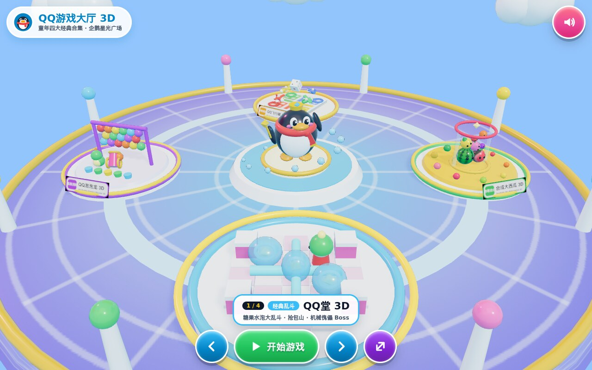

# QQ游戏大厅 3D — 童年四大经典合集 (`QQ Game Hall 3D`)

**Live 3D Arcade Plaza & Portal:** [https://kunruiw1991.github.io/qq-game-hall-3d/](https://kunruiw1991.github.io/qq-game-hall-3d/)  
**GitHub Repository:** [https://github.com/kunruiw1991/qq-game-hall-3d](https://github.com/kunruiw1991/qq-game-hall-3d)



---

## 四大 3D 经典游戏一览 (`All 4 Standalone 3D QQ Classics`)

| # | 游戏名称 (`Game Title`) | 核心 3D 玩法与微缩岛景观 (`3D Gameplay & Showcase Diorama`) | 在线试玩 (`Live GitHub Pages`) | 源码仓库 (`GitHub Repo`) | 大厅直达锚点 (`Deep Link`) |
| :-: | :--- | :--- | :--- | :--- | :--- |
| **1** | **QQ堂 3D**<br>(`QQ Tang: Candy Bubble Arena 3D`) | 糖果水泡竞技场 · 抢包山 · 机械傀儡 Boss<br>3D 米多与弹跳半透明糖果水泡 + 十字水柱微缩岛 | [https://kunruiw1991.github.io/qq-tang-3d/](https://kunruiw1991.github.io/qq-tang-3d/) | [kunruiw1991/qq-tang-3d](https://github.com/kunruiw1991/qq-tang-3d) | [`#tang`](https://kunruiw1991.github.io/qq-game-hall-3d/#tang) |
| **2** | **合成大西瓜 3D**<br>(`Synthetic Big Watermelon 3D`) | 11 阶 3D 水果刚体物理碰撞 · 摇一摇 · 金西瓜喷泉<br>透明水晶玻璃罐 + 翻滚 3D 大西瓜与多阶鲜果微缩岛 | [https://kunruiw1991.github.io/qq-watermelon-3d/](https://kunruiw1991.github.io/qq-watermelon-3d/) | [kunruiw1991/qq-watermelon-3d](https://github.com/kunruiw1991/qq-watermelon-3d) | [`#watermelon`](https://kunruiw1991.github.io/qq-game-hall-3d/#watermelon) |
| **3** | **QQ飞行棋 3D**<br>(`QQ Aeroplane Chess 3D`) | 四色 3D 双翼飞机 · 5/6 起飞 · 同色跳棋 · 虚线飞棋航线<br>3D 十字棋盘 + 4 架盘旋双翼机与翻滚 3D 骰子微缩岛 | [https://kunruiw1991.github.io/qq-aeroplane-chess-3d/](https://kunruiw1991.github.io/qq-aeroplane-chess-3d/) | [kunruiw1991/qq-aeroplane-chess-3d](https://github.com/kunruiw1991/qq-aeroplane-chess-3d) | [`#aeroplane`](https://kunruiw1991.github.io/qq-game-hall-3d/#aeroplane) |
| **4** | **QQ泡泡龙 3D**<br>(`QQ Bubble Dragon Shooter 3D`) | 齿轮泡泡发射大炮 · 墙壁反弹 · 悬空雪崩掉落加分<br>黄铜齿轮泡泡大炮 + 泡泡小恐龙与彩虹六边形泡泡阵微缩岛 | [https://kunruiw1991.github.io/qq-bubble-dragon-3d/](https://kunruiw1991.github.io/qq-bubble-dragon-3d/) | [kunruiw1991/qq-bubble-dragon-3d](https://github.com/kunruiw1991/qq-bubble-dragon-3d) | [`#bubbledragon`](https://kunruiw1991.github.io/qq-game-hall-3d/#bubbledragon) |

---

## 核心特性 (`Key Highlights`)

1. **互动 3D 企鹅星光广场与旋转微缩岛 (`Interactive 3D Sky Plaza & 4 Miniature Diorama Islands`)**
   - 基于 **Three.js r170 (`WebGL2`)** 构建，零外部图片/音频依赖，100% 相对路径 ES2022 模块加载（无 `<script type="importmap">`，完美兼容 iPadOS Safari 与桌面浏览器）。
   - 广场中央矗立佩戴经典红围巾、挥手迎宾的 **3D 经典 QQ 企鹅主持 (`QQ Penguin Host`)** 与双层星光喷泉，四周环绕 **4 座实时物理/动画驱动的 3D 微缩游戏展示岛**。
2. **双模式畅玩体验 (`Dual Play Experience: Seamless Embedded Play + Standalone Launch`)**
   - **大厅内嵌无缝畅玩 (`🎮 开始游戏`)**：点击主按钮或居中 3D 游戏岛，直接在 `<iframe allow="autoplay; fullscreen">` 容器内启动所选游戏，独立 84px 导航栏配备大尺寸 **`🏠 大厅` 返回按钮 (`>= 68x68px`)**（与子游戏画面零重叠），让小朋友在 iPad 上只需收藏一个书签即可自由切换全部 4 款经典游戏。
   - **智能背景音乐联动 (`Smart BGM Auto-Pause & Resume`)**：进入内嵌游戏或隐藏标签页时自动暂停大厅 WebAudio 背景音乐，点击 `🏠 大厅` 返回时平滑恢复大厅音乐。
   - **独立窗口启动 (`↗`)**：同时提供一键在新标签页打开独立游戏站点。
3. **儿童友好触控与键盘操控 (`Kid-Friendly Touch & Desktop Controls`)**
   - 同屏可见可点击按钮严格控制在 `<= 6` 个（大厅模式 5 个、内嵌模式 1 个），所有触控按钮尺寸 `>= 68x68px`，在 `1280x800`、`1024x768`、`844x390`、`390x844` 四种视口下零滚动条、零重叠。
   - **触控 / 鼠标**：1:1 左右滑动旋转 3D 转盘；直接点击任意偏心 3D 展示岛将其旋转至正前方，再次点击正前方 3D 展示岛直接进入游戏；点击中央 3D 企鹅触发欢呼挥手特效。
   - **键盘快捷键**：`←` / `→`（或 `A` / `D`、`1`–`4`）切换游戏岛，`Enter` / `Space` 启动当前游戏，`Esc` 从内嵌游戏返回大厅，`M` 切换静音。

---

## 确定性诊断接口 (`Deterministic Test Seam: window.__QQ_HALL__`)

`Object.freeze(window.__QQ_HALL__)` 提供以下无后门确定性方法：

- `selectGame(id)`：按游戏 ID (`'tang' | 'watermelon' | 'aeroplane' | 'bubbledragon'`)、仓库别名或索引 (`0..3`) 选中对应 3D 游戏岛并同步 URL Hash。
- `rotateCarousel(delta)`：支持离散步进（如 `+1` / `-1`）与连续弧度偏移旋转转盘。
- `openEmbedded(id, opts)`：在全屏 `<iframe allow="autoplay; fullscreen">` 中加载指定游戏并自动暂停大厅 BGM。
- `closeEmbedded()`：关闭内嵌游戏容器、返回 3D 企鹅广场并自动恢复大厅 BGM。
- `stepFrames(n)`：以固定步长 `FIXED_DT = 1/60s` 推进 `n` 帧广场与 4 座微缩岛 3D 物理动画并同步渲染。
- `getState()`：返回当前大厅、转盘角度、企鹅主持、4 座 3D 游戏岛、内嵌播放器、WebAudio 与 WebGL2 渲染指标的深拷贝快照。

---

## 本地运行与自动化验证 (`Local Server & E2E Verification`)

```bash
# 启动本地静态服务器
python3 -m http.server 18804 --bind 127.0.0.1

# 运行完整 28 项无头 Chrome WebGL2 端到端测试套件 (Tiers 1–4)
python3 -B tests/run_e2e.py --tier all
```
